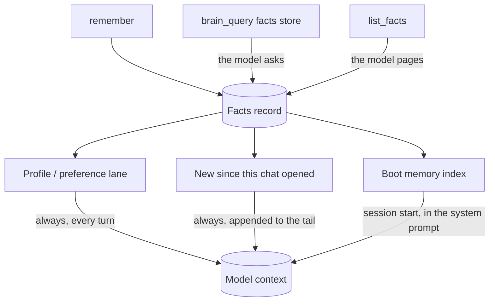

# Memory lanes

Stored memory reaches a turn through two automatic routes, and everything beyond
them is a search the model has to ask for. Confusing the automatic lanes with
search is the usual reason a "why did it not remember" investigation goes wrong.

## The two automatic lanes

**Profile lane.** Facts stored with `kind='profile'` or `kind='preference'` are
rendered first, inside a budget of about 600 characters, on every turn. There is
no keyword match and no setting to arm. This is what makes August remember who
you are without waiting for a query to hit. A fact dropped for budget is named in
a `recall partial:` line rather than disappearing silently.

**Memory delta.** A plain list of facts written or updated since this chat
opened, appended to the prompt tail. It is a projection over the facts record,
not a cursor and not a second store, so an update to an existing key arrives
like a new write and a retired row cannot resurface. The comparison is on
`updated_at` at microsecond resolution, which is what lets a fact written in the
opening second of a chat be visible on the next request.

## The pull doors

There is no per-turn ranked tail and no `memoryAutoInject` setting: the key was
deleted from the brain config, so a config file or script that still writes it is
writing a key nothing reads. A ranked search happens when the model calls
`brain_query` with the `facts` store, and `list_facts` pages the record with
`offset` / `total` / `hasMore`.

Ranking survives only inside those explicit doors, plus the near-duplicate check
that keeps `remember` from filing a second copy of an existing fact — the two
places a query exists at all. It is not attached to a turn because it cannot
carry one: measured on the real 19-fact store, BM25 returned nothing for "what
should I set my editor theme to" against the fact that says "Prefers dark mode",
and ranked the wrong fact first for "what am I doing my degree in".

## Writing

`remember`, `list_facts` and `forget` are core tools, so progressive disclosure
can never hide the lookup that `remember` depends on, and a downgraded weak model
can still correct what it remembers.

A write is a file write: `remember` refuses a sentence already stored under a
different key, naming that key in the result. A new memory may be checked by the
fresh-context reviewer, but a reviewer that cannot answer is not a veto. Subagents
read and recall but never write; the parent turn is the only model-facing write
door, and internal and UI routes also call the same store function directly.

## What survives a reset

Backups are a verified `tar.gz` of `memory/` + `state/` + `config.json` with a
SHA-256 manifest: every archive is re-opened and every file hash is checked before
one is trusted, and retention is a verified rolling set. A restore is staged and
applied at the next launch, never swapped in place, because other threads still
hold the record files open for atomic writes. What a restore replaced is kept
beside it as `<name>.pre-restore`.